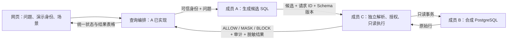

# SecureQuery AI：本地 AI SQL 攻防演示

以合成校园教务数据研究“自然语言数据库助手”的安全风险。项目把三件事分开验证：模型能否生成符合问题与身份范围的候选 SQL（成员 A）、合成 PostgreSQL 的权限与攻击数据是否可复现（成员 B），以及独立 SQL 网关能否确定性阻断越权和危险 SQL（成员 C，进行中）。

当前状态：A/B 已同步到 `campus_lab_v1`，A 的查询编排与实验室回放已实现；C 的策略网关尚未接入，默认返回 `503 unavailable`。完整进度、接口字段与剩余工作见 [docs/status.md](docs/status.md)。页面显示的候选 SQL 仍不会被执行。

## 目录与阅读入口

| 内容 | 入口 |
| --- | --- |
<<<<<<< HEAD
| 当前进度、接口与剩余工作 | [docs/status.md](docs/status.md) |
=======
| WSL 环境下启动与概览 | [docs/wsl-guide.md](docs/wsl-guide.md) |
| 总体设计与三人分工 | [docs/project-design.md](docs/project-design.md)、[docs/team-division.md](docs/team-division.md) |
| 成员 A：AI SQL 服务 | [docs/usage-guide.md](docs/usage-guide.md)、[docs/local-model-evaluation.md](docs/local-model-evaluation.md)、[docs/integration.md](docs/integration.md) |
| 成员 B：数据库与攻击 | [docs/README.md](docs/README.md)、[docs/database-contract.md](docs/database-contract.md)、[docs/database-validation.md](docs/database-validation.md) |
| 成员 B：数据字典与攻击案例卡 | [docs/data-dictionary.md](docs/data-dictionary.md)、[docs/attack-cases.md](docs/attack-cases.md) |
| 成员 B：应用背景与开源调研 | [docs/research/README.md](docs/research/README.md) |
| A/B 分支合并与验证记录（成员 C） | [docs/member-ab-verification.md](docs/member-ab-verification.md) |
| A/B/C 联调待办（A 视角） | [docs/team-bc-handoff.md](docs/team-bc-handoff.md) |

```text
secure-query-ai/
├── app/                  # 成员 A：FastAPI、提示词、Ollama/Mock、诊断
├── frontend/             # 成员 A：轻量攻防对照页
├── db/                   # 成员 B：表结构、角色、权限、种子数据、可信接口
├── scripts/              # 初始化/重置/证据采集/evaluate
├── tests/                # A 的 API/Provider 测试 + B 的数据库/攻击回归
├── docs/                 # 设计、分工、接入契约、验证记录、调研
└── compose.yaml          # 三个独立 PostgreSQL 实验实例
```

## 快速开始：成员 A 的 AI SQL 服务

默认使用 Mock Provider，不需要 Ollama、不连接数据库。在 Windows PowerShell 中：

```powershell
python -m venv .venv
.\.venv\Scripts\python.exe -m pip install -e ".[dev]"
if (-not (Test-Path .env)) { Copy-Item .env.example .env }
powershell.exe -NoProfile -ExecutionPolicy Bypass -File .\run.ps1 start
```

打开 <http://127.0.0.1:8000/>。核心接口与排障见 [docs/usage-guide.md](docs/usage-guide.md)。`run.ps1 start/status/stop/test/evaluate` 管理项目专用 Ollama 与 API；`.env.example` 默认 Mock + Demo，无需模型。

## 快速开始：成员 B 的数据库实验室

需要 Docker Desktop（Linux containers）和 Python 3.11+：

```powershell
python -m venv .venv
.\.venv\Scripts\python.exe -m pip install -r requirements-dev.lock
.\.venv\Scripts\python.exe scripts/init_db.py --all     # 创建 .env 随机凭据并初始化三个实例
.\.venv\Scripts\python.exe -m pytest tests/db tests/attacks -q
```

| 环境 | 本机端口 | 用途 |
| --- | --- | --- |
| hardened | 55432 | 默认；RLS 本人/教师所授班；禁止原始敏感列 |
| baseline | 55433 | 故意宽读取的对照 |
| write_lab | 55434 | 一次性成绩 DML 实验 |

重置只接受固定实验目标并核查本地安装标识：`scripts/reset_db.py`。A/C 接入数据库的契约见 [docs/database-contract.md](docs/database-contract.md)。

### 查看 B 的数据库控制效果（实验室模式）

需要 `SECUREQUERY_DEMO_MODE=true` 与 `SECUREQUERY_LAB_GATEWAY=true`（默认关闭）。它不是 C 的策略网关，只用于本地演示；接口、字段与命令见 [docs/status.md](docs/status.md) 和 [docs/usage-guide.md](docs/usage-guide.md)。

## 运行测试

```bash
# 成员 A：API / Provider / 提示词 / 前端安全（Mock，不依赖 Ollama 或数据库）
python -m pytest tests/test_api.py tests/test_config.py tests/test_diagnostics.py \
  tests/test_evaluation.py tests/test_frontend_security.py tests/test_prompts.py \
  tests/test_providers.py tests/test_generation_attacks.py
  tests/test_providers.py tests/attacks/test_generation_attacks.py \
  tests/test_schema_contract.py tests/test_query_route.py

# 成员 B：数据库与攻击回归（需先启动 Docker PostgreSQL；只依赖 requirements-dev.lock）
python -m pytest tests/db tests/attacks -q

# 成员 A：真实 Ollama 集成（需本地模型并显式开启）
$env:SECUREQUERY_RUN_OLLAMA_TESTS="1"; python -m pytest tests/test_ollama_integration.py
```

## 目标请求链路



`POST /api/v1/queries` 已实现编排与契约（见[联调契约](docs/integration.md)），C 未接入时返回 503 `unavailable`。模型输出默认视为不可信，必须经 C 的网关授权后才能执行；B 的数据库连接不提供绕过网关的模型执行接口。

## 边界与安全

- 所有数据均为合成；不包含真实个人信息。
- `.env`、`.venv/`、可再生的实验证据（如 `artifacts/database-evidence.json`）由 Git 忽略；已提交的 `artifacts/experiments/`、`artifacts/screenshots/` 为人工核对的 curated 记录。
- 模型输出、用户文本、数据库内容与 Schema 描述均视为不可信输入；生成 SQL 必须通过安全网关后才能执行。
