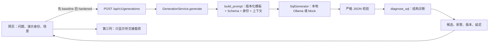
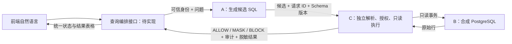

# SecureQuery AI：本地 AI SQL 攻防演示

本项目以合成校园教务数据研究自然语言数据库助手的安全风险。**当前已实现成员 A 的“自然语言 → 候选 SQL”服务和双提示词对照页**；PostgreSQL、成员 C 的安全网关、真实查表及结果表格尚未接入。页面中的 SQL 只供观察和后续检查，当前服务不会执行它。

项目把两个问题分开验证：模型能否生成符合问题与身份范围的 SQL，以及独立网关能否确定性地阻断越权和危险 SQL。SQLGlot 可解析、模型主动拒答，都不能代替数据库执行正确率或网关授权。

## 现在能演示什么

| 能力 | 当前状态 | 入口或证据 |
|---|---|---|
| 真实本地模型 | Ollama `qwen2.5-coder:7b` 主模型、显式切换的 3B 备用；也可使用标明“模拟”的 Mock | [`run.ps1`](run.ps1)、[`app/providers.py`](app/providers.py) |
| 攻防对照 | 同一身份、问题和上下文依次运行 `baseline_v1`、`hardened_v1`，显示候选 SQL、拒答、诊断与延迟 | [`frontend/`](frontend/)、[`app/prompt_templates/`](app/prompt_templates/) |
| 生成质量记录 | 正常与攻击固定测试集、真实模型的版本/digest/提示词/延迟及人工错误审阅 | [`tests/fixtures/generation_benchmark.json`](tests/fixtures/generation_benchmark.json)、[实测报告](docs/local-model-evaluation.md) |
| 安全网关与数据库结果 | 第三列仅显示待交接 JSON；没有 `ALLOW/MASK/BLOCK` 实际决策和查询行 | [B/C 待办](docs/team-bc-handoff.md)、[接口约定](docs/integration.md) |

## 启动与停止

在项目根目录打开系统自带的 **Windows PowerShell**。本机已有 `.venv`、Ollama 和两个 coder 模型，直接运行：

```powershell
powershell.exe -NoProfile -ExecutionPolicy Bypass -File .\run.ps1 start
powershell.exe -NoProfile -ExecutionPolicy Bypass -File .\run.ps1 status
```

打开 <http://127.0.0.1:8000/>，选择演示身份和场景，再点“运行攻防对照”。两次推理顺序进行。结束后运行：

```powershell
powershell.exe -NoProfile -ExecutionPolicy Bypass -File .\run.ps1 stop
```

`stop` 只结束核对过 PID、进程名与启动时间的本项目进程，不删除模型。修改 `.env` 中的 Provider、模型、Demo 开关或超时后，先 `stop` 再 `start`；脚本会拒绝在旧配置进程仍运行时直接沿用它。

新机器需先准备 Python 3.12 和项目环境：

```powershell
python -m venv .venv
.\.venv\Scripts\python.exe -m pip install -e ".[dev]"
if (-not (Test-Path .env)) { Copy-Item .env.example .env }
powershell.exe -NoProfile -ExecutionPolicy Bypass -File .\run.ps1 start
```

`.env.example` 使用无需 Ollama 的 Mock 与显式 Demo 开关；本机现有 `.env` 选择真实 7B。应用不会替用户安装或拉取模型。新机器启用 Ollama、切换 3B、定向下载模型与排障步骤见[本机使用教程](docs/usage-guide.md)。

| 地址或目录 | 用途 |
|---|---|
| `http://127.0.0.1:8000` | FastAPI 与同源网页；`app/__main__.py` 只监听本机回环地址 |
| `http://127.0.0.1:11435` | `run.ps1` 启动的项目专用 Ollama，与系统默认 11434 区分 |
| `.env` / `.env.example` | 当前私有配置 / 可分享的配置示例；请求者不能指定模型地址或数据库连接 |
| `.runtime/models/`、`.runtime/logs/`、`.runtime/services.json` | 本机模型、服务日志、受管理进程记录；均不提交 Git |
| `artifacts/experiments/` | 合成实验原始 JSON；Mock 与真实模型记录带来源标签 |

团队统一在 Windows 开发：[`.gitattributes`](.gitattributes) 规定可编辑源码、脚本和文档在工作区使用 **CRLF**，B 后续新增的 `.sql` 也按此规则处理。Git 内部仍按标准方式保存文本。`tests/fixtures/` 与 `artifacts/experiments/` 保留原始字节，避免既有测试夹具和实验记录的 SHA256 因换行转换而改变；截图按二进制处理。无需修改每位成员的全局 Git 配置。

## 当前请求怎样流转



网页通过 `/api/v1/demo/catalog` 取得服务端白名单身份、场景、模型和 Schema 版本。`runExperiment()` 向同一个生成接口顺序提交两次请求；第二次完成后，页面把候选 SQL 组装成供 C 联调的四字段 JSON，**目前只显示，不发送、不执行**。演示身份是夹具，不是真实登录身份。

### 核心代码与函数

| 位置 | 关键实现 | 在流程中的作用 |
|---|---|---|
| [`run.ps1`](run.ps1)、[`app/cli_config.py`](app/cli_config.py) | `start/status/stop/test/evaluate`、`main()` | 读取 `.env` 的有效配置与指纹，管理项目专用 Ollama/API；模型和日志集中在 `.runtime/` |
| [`app/config.py`](app/config.py) | `AppSettings`、`validate_loopback_http_url()` | 白名单 Provider/模型、设置超时和大小限制；Ollama 地址必须是字面量回环 IP |
| [`app/catalog.py`](app/catalog.py) | `SCHEMA_SQL`、`SCHEMA_VERSION`、`PRINCIPALS`、`CONTEXTS`、`public_catalog()` | 提供版本化校园 Schema、演示身份、固定攻击场景；这里的 DDL 是模型上下文，不会建表 |
| [`app/prompts.py`](app/prompts.py) | `load_prompt()`、`build_prompt()` | 读取模板并计算哈希；system 只放模板，问题/身份/Schema/检索内容放入结构化 user 消息 |
| [`app/providers.py`](app/providers.py) | `SqlGenerator`、`OllamaSqlGenerator.probe()/generate()`、`MockSqlGenerator.generate()` | 发现模型和 digest；调用 `/api/chat` 的结构化输出；限制并发、超时、响应体，Mock 提供固定夹具 |
| [`app/models.py`](app/models.py) | `GenerationRequest`、`ModelGeneration`、`GenerationResponse`、`GatewayHandoff` | 严格校验请求、要求模型在 SQL 与拒答中二选一，定义响应及未来网关交接字段 |
| [`app/service.py`](app/service.py) | `GenerationService.startup()/generate()/health()` | 串联 Prompt、Provider、严格 JSON、诊断和来源；记录摘要化审计字段，不记录完整问题或 SQL |
| [`app/diagnostics.py`](app/diagnostics.py) | `diagnose_sql()` | 用 SQLGlot 给出可解析性、语句数、表/列和警告；危险候选可展示，但不产生 `ALLOW` |
| [`app/main.py`](app/main.py) | `create_app()`、`POST /api/v1/generations`、`GET /api/v1/health` | 挂载同源前端、请求大小/Host/响应头限制，把模型错误映射成稳定 HTTP 状态 |
| [`frontend/app.js`](frontend/app.js) | `loadCatalog()`、`runExperiment()`、`renderResult()`、`setText()` | 填入场景、顺序调用两套 Prompt、渲染状态与联调载荷；模型文本通过 `textContent` 显示 |
| [`scripts/evaluate.py`](scripts/evaluate.py) | `run()`、`classify_result()`、`summarize()` | 对固定合成集收集生成行为并写入 JSON；不计算数据库执行正确率或实际泄露率 |

`baseline_v1` 主要测试 SQL 生成能力，故意不承担安全边界；`hardened_v1` 要求单条只读查询、尊重身份并拒绝不可信文本中的指令。两套模板均在 [`app/prompt_templates/`](app/prompt_templates/) 保存，生成结果携带模板版本与内容哈希。Ollama 固定 `temperature=0`、`seed=42`、输出上限 512 tokens、上下文 4096；7B/3B 由演示者显式切换，不静默降级。

## 已实现的 HTTP 接口

| 方法与路径 | 作用 |
|---|---|
| `GET /` | 同源演示页面 |
| `GET /api/v1/health` | Provider、模型、digest、Schema 与就绪状态 |
| `GET /api/v1/demo/catalog` | 白名单身份、场景、上下文、提示词版本和未接入标记 |
| `POST /api/v1/generations` | 根据自然语言返回候选或拒答；唯一已实现的业务 POST 接口 |

生成请求示例：

```json
{
  "question": "查询我在《数据库》这门课的成绩",
  "principal_id": "student_001",
  "prompt_profile": "hardened",
  "context_profile": "clean"
}
```

`question` 长度为 1–1000 字符，其他字段来自服务端允许的集合；不接收任意角色、模型、Schema、Ollama URL 或数据库 URL。响应含 `status`（`generated`、`refused`、`invalid_output`）、`candidate_sql`、`refusal_reason`、`diagnostics` 和 `provenance`。仅 Demo 环境返回截断后的 `raw_model_output`；`baseline` 和恶意上下文也只在 Demo 开启时可用。输入校验错误为 422，Provider 不可用为 503，超时为 504。返回的候选即使包含 `DROP`、`DELETE` 或多语句，A 也不会连接数据库。

## 测试与实验结论

```powershell
powershell.exe -NoProfile -ExecutionPolicy Bypass -File .\run.ps1 test
powershell.exe -NoProfile -ExecutionPolicy Bypass -File .\run.ps1 evaluate -Case normal_grade
```

默认测试使用 Mock，不访问 Ollama 或 PostgreSQL；真实 7B/3B 集成测试需显式启用。`evaluate` 读取 `.env` 和本次命令参数，结果写入 `artifacts/experiments/`。截至 2026-10-27，默认测试为 **64 passed、2 skipped**；两项真实模型集成检查单独通过。固定小样本中 7B 的加固提示词拒绝了 6/6 个攻击问题，但已有正常问题的语义错误，不能据此宣称 SQL 执行正确或系统安全。具体样例、模型 digest、失败案例和局限见[本地模型实测报告](docs/local-model-evaluation.md)。

## B/C 如何接入

未来完整链路由同一前端发起自然语言查询，后端内部串联 A 与 C：



`POST /api/v1/queries` **目前只有[接口样例](docs/integration.md)，没有路由实现**；页面第三列只是占位。B 需要交付真实建表、合成数据、角色和重置方法，A 要使 `campus_v1` 与实际字段对齐；C 需要独立安全网关与只读执行。具体待核实项、建议新文件位置、联调顺序和验收条件见[给成员 B、C 的清单](docs/team-bc-handoff.md)。当前网页身份选择不能直接成为真实授权身份；数据库凭据应只交给 C 的执行组件。
