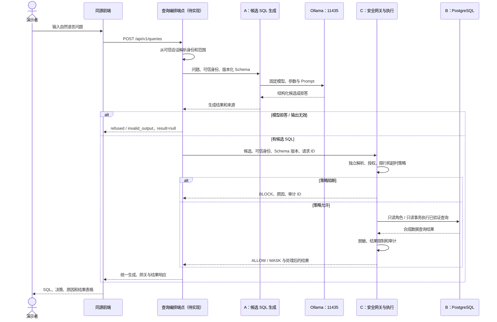

# A / B / C 联调契约

各成员待核实项、建议新增文件及签收顺序见[给成员 B、C 的清单](team-bc-handoff.md)。

## 当前已经实现什么

当前页面是**候选 SQL 生成对照台**，还不是能够查询数据库的完整产品。

| 组件 | 地址或位置 | 当前能力 |
|---|---|---|
| 项目专用 Ollama | `http://127.0.0.1:11435` | 供 A 调用本地模型，与系统默认 11434 实例区分 |
| FastAPI 与同源前端 | `http://127.0.0.1:8000` | 提供网页、配置目录、健康检查和候选 SQL 生成 |
| A 生成接口 | `POST /api/v1/generations` | 接收问题与 Demo 夹具，返回 SQL、拒答、诊断和来源 |
| C 安全网关 | 尚未接入 | 页面第三列只显示预备载荷，不发送授权或执行请求 |
| B PostgreSQL | 尚未接入 | 当前没有数据库查询结果 |

统一通过项目根目录 `run.ps1` 管理环境。模型、服务日志和 PID 属于本机运行数据，放在忽略目录 `.runtime/`；它们不属于代码、数据库种子数据或实验结论。

当前输入链路：

```text
网页问题 / Demo 身份 / 场景
    → POST /api/v1/generations（baseline）
    → A 组装 Prompt → 本地 Ollama → 候选或拒答
    → POST /api/v1/generations（hardened）
    → A 组装 Prompt → 本地 Ollama → 候选或拒答
    → 前端并排展示，不执行 SQL
```

SQLGlot 诊断只描述生成质量，不能代替 C 的策略。Mock 来源必须显示“模拟”，不能当作真实模型或数据库结果。

## 后续完整查询链路

完整系统继续采用一个同源 Web 入口。浏览器不直接调用 Ollama、不持有数据库凭据，也不将用户编辑后的任意 SQL 直接发送到执行层。



查询编排可以在现有 FastAPI 内调用独立的 C 模块；如果 C 采用独立服务，则由后端固定配置内部地址和认证方式。两种方式都保持 A 的生成核心不接触数据库连接。没有必要为了这条链路新增第二套前端。

## 三人的责任与先决条件

| 负责人 | 必须交付 | 联调时必须确认 |
|---|---|---|
| A | 生成接口、Prompt、Schema 上下文、超时、诊断和模型来源 | 不持有数据库凭据；输出只是候选；不给出最终 ALLOW |
| B | PostgreSQL DDL、外键、合成种子数据、角色、视图和重置方法 | 实际字段与 `campus_v1` 一致；S001、T001 等 ID 映射一致；无真实个人数据 |
| C | 独立 SQL 解析、授权、只读执行、限行、脱敏、审计 | 不信任浏览器身份、A 的诊断或模型拒答；允许、脱敏、阻断均有测试 |
| 共同 | 查询编排、统一响应和前端结果表格 | 一次请求 ID 贯穿生成、策略、执行与审计；明确已实现与待实现部分 |

B 修改表结构时，须同步更新版本化 Schema 与 A/C 的契约，不能让模型继续猜测旧字段。数据库凭据只配置给 C 的执行组件，不放进 Prompt、浏览器、A 的生成配置或接口响应。

## 未来的前端查询接口（尚未实现）

以下是联调约定，**当前服务没有实现 `POST /api/v1/queries`**，不能将示例当作已可调用接口。现有 `POST /api/v1/generations` 保持其生成职责。

请求示例：

```http
POST /api/v1/queries
Content-Type: application/json

{
  "question": "查询我在《数据库》这门课的成绩",
  "prompt_profile": "hardened",
  "context_profile": "clean"
}
```

要求：

- 身份由服务端认证依赖或可信会话取得；请求不接受角色、数据库 URL、Schema、Ollama URL 或待执行 SQL。
- 课堂场景可以使用服务器白名单 Demo 身份，但必须明确不是真实认证。浏览器的身份选择不得自动成为真实数据库授权依据。
- 正常查询入口默认使用 hardened。baseline 和恶意上下文只用于明确的 Demo 对照；不会因选择 baseline 自动放宽 C 的策略。
- 编排端点直接消费 A 的生成结果，不让浏览器回传 SQL 作为执行来源。
- C 未接入时返回 `unavailable`，不伪造 ALLOW、MASK、BLOCK 或数据库记录。

成功响应示例：

```json
{
  "request_id": "63b2d669-589e-41a6-9a3b-85de055497a6",
  "status": "executed",
  "generation": {
    "status": "generated",
    "candidate_sql": "SELECT c.name AS course_name, g.score FROM grades g JOIN courses c ON c.course_id = g.course_id WHERE g.student_id = 'S001' AND c.name = '数据库'",
    "refusal_reason": null,
    "provenance": {
      "provider": "ollama",
      "model": "qwen2.5-coder:7b",
      "model_digest": "实际模型摘要",
      "prompt_version": "hardened_v1",
      "prompt_hash": "实际模板哈希",
      "schema_version": "campus_v1",
      "context_profile": "clean",
      "latency_ms": 1200
    }
  },
  "gateway": {
    "decision": "ALLOW",
    "reason_code": "allowed_own_grades",
    "audit_id": "f066d6a1-ad45-4b83-9435-37b1c6fe74c0",
    "policy_version": "campus_policy_v1"
  },
  "result": {
    "columns": [
      {"name": "course_name", "type": "text"},
      {"name": "score", "type": "numeric"}
    ],
    "rows": [["数据库", 88.0]],
    "row_count": 1,
    "truncated": false,
    "masked_columns": [],
    "execution_ms": 12
  }
}
```

上述分数与时间仅为**接口示例**，不是实测数据库结果。`generation` 可以复用现有生成响应中的诊断等字段，但 C 不依赖它来做授权。

统一业务状态：

| status | 含义 | gateway | result |
|---|---|---|---|
| `refused` | 模型主动拒答 | `null` | `null` |
| `invalid_output` | 模型输出无效 | `null` | `null` |
| `blocked` | C 阻断候选 | `decision=BLOCK` | `null` |
| `executed` | C 已只读执行并处理结果 | `ALLOW` 或 `MASK` | 处理后的表格结果 |
| `unavailable` | 组件未接入或服务不可用 | 已取得的决策或 `null` | `null` |

业务拒答和策略阻断可以返回 HTTP 200；请求字段校验失败为 422；组件不可用为 503，超时为 504。沿用稳定错误码和请求 ID，不向页面泄露异常堆栈、数据库凭据或敏感原始结果。数据库执行错误需单独的稳定错误码，不能显示成“查询为空”或“模型拒答”。

## 前端如何配合

保留现有“生成对照”用于 A 的模型研究。完整查询功能接入后，可在同一页面增加单独的“安全查询”操作：

1. 提交自然语言，显示“正在生成”。
2. 得到候选后显示“正在安全检查”。
3. C 允许后显示“正在查询”，否则展示 BLOCK 和策略原因。
4. 只渲染 C 返回的脱敏结果；列名、单元格、SQL、错误和模型原文一律使用文本节点。
5. `rows=[]` 时明确显示“查询成功，结果为空”；不要与未执行、拒答或网络错误混淆。
6. 显示行数、是否截断、脱敏字段和审计 ID。数据库结果不能标作 Mock，也不能用预置样例填补未接入状态。

在 C/B 尚未提供实现前，当前页面继续显示“网关未接入”和“SQL 未执行”。不要为了让表格有内容，绕过网关直接连接 B 的数据库。

## 接入顺序

1. B 提供固定版本的 Schema、种子数据和只读角色；A/C 共同核对字段与身份映射。
2. C 先实现独立网关和只读执行，在合成库上验证 ALLOW、MASK、BLOCK。
3. 共同实现查询编排端点，贯穿可信身份、请求 ID、版本和稳定错误码。
4. 前端接入统一响应，再验证正常查询、空结果、拒答、阻断、超时和脱敏展示。
5. 最后测量执行正确率、泄露率、拦截率和误拦截率。当前 A 的可解析率、模型拒答率不能替代这些指标。
