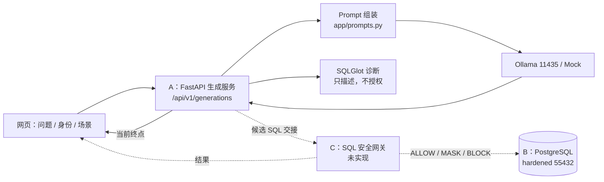

# 成员 A 视角：AI SQL 服务梳理、Docker 接入与下一步实施

日期：2026-10-30。分支：`hongcl`。适用对象：成员 A（AI SQL 服务负责人），同时供 B/C 联调时对照。

> 当前进度摘要与剩余工作见 [状态与交接](status.md)；本文保留 A 的实现细节与决策记录。

本文只描述**代码里真实存在的行为**。规划中的功能会明确标注“未实现”。所有结论都可以用文末命令复现。

---

## 0. 先看结论

| 问题 | 当前答案 |
| --- | --- |
| A 的生成链路完成了吗？ | 完成。`网页 → FastAPI → Prompt → Ollama/Mock → 候选 SQL + 诊断 + 来源` 可运行 |
| 生成结果会执行吗？ | **不会**。A 的服务不导入数据库驱动、不连接数据库、没有执行 SQL 的代码 |
| 有真实查询路由吗？ | 有。`POST /api/v1/queries` 已实现编排与契约；默认 C 未接入时返回 HTTP 503 + `status=unavailable`，实验室模式可直连 B |
| B 的数据库能直接用吗？ | 能。2026-10-30 已在本机完成接入：三个实例 healthy、`clean` 摘要一致、`tests/db + tests/attacks` 74 项通过 |
| 现在能看到 B 的效果吗？ | 能（实验室模式）：`/api/v1/queries` 正常查询返回真实行；`/api/v1/lab/replay/{id}` 稳定返回 `42501`、`25006`、RLS 0 行 |
| Schema 对齐了吗？ | 已对齐（2026-11-01）：升级为 `campus_lab_v1`，Mock 与参考 SQL 可在 hardened 库执行 |
| 当前最大阻塞是什么？ | 只剩 C 的安全网关与执行器；真实模型需按 v2 重跑评估 |
| C 的网关完成了吗？ | 没有。前端第三列明确显示“未接入”，没有伪造 ALLOW/BLOCK |

本机实测（2026-10-30）：

- `127.0.0.1:8000` 的 API 正在运行，provider 为 `ollama / qwen2.5-coder:7b`，digest `dae161e2…f4364`，`demo_mode=true`。
- A 的离线测试 **80 passed**（安装 `requirements-dev.lock` 后）。真实 Ollama 集成测试默认跳过，需显式开启。
- Docker Desktop 已启动（`OSType: linux`），三个实验实例均已初始化并 `healthy`，端口 55432/55433/55434。
- `tests/db + tests/attacks` **74 passed**；实验室直连/回放 **12 passed**；全套 `pytest` 为 **163 passed / 2 skipped**（跳过的是需显式开启的 Ollama 集成）。
- 注意：`docs/database-validation.md` 中的“71 passed”是 2026-10-28 的记录，当前测试数已增长，以实际 collect 结果为准。

---

## 1. 项目在做什么

研究问题：自然语言数据库助手在“模型可能被诱导或犯错”的前提下，如何把风险限制在可验证的边界内。

三个人各管一层，边界是刻意设计的：

```text
浏览器
  │  只提交自然语言 + 演示身份；不持有数据库凭据，不回传 SQL 作为执行来源
  ▼
A：生成层（app/）
  │  组装系统 Prompt + 可信 Schema + 受限上下文 → 本地 Ollama → 候选 SQL / 拒答
  │  只做语法诊断，不做授权；绝不执行 SQL
  ▼
C：安全网关（未实现）
  │  独立解析、授权、限行、脱敏、审计；只有它能拿到数据库连接
  ▼
B：数据层（db/）
     合成 PostgreSQL、RLS、列权限、只读角色、种子数据
```



**三条不可越过的线**（也是验收时的答辩点）：

1. 模型输出、用户文本、数据库内容、Schema 描述全部视为不可信输入。
2. A 的诊断结果不是授权；只有 C 的网关能给出 `ALLOW/MASK/BLOCK`。
3. 数据库凭据只给 C 的执行组件，不进入 Prompt、浏览器、A 的配置或接口响应。

---

## 2. 已完成内容清单

### 2.1 成员 A（本分支主体）

| 能力 | 位置 | 说明 |
| --- | --- | --- |
| Web API | `app/main.py` | 健康检查、演示目录、候选生成、静态前端 |
| 生成编排 | `app/service.py` | 校验 Demo 开关 → 组装 Prompt → 调 Provider → 严格 JSON 解析 → 诊断 → 审计日志 |
| Provider 抽象 | `app/providers.py` | `MockSqlGenerator` 与 `OllamaSqlGenerator` 共用 `SqlGenerator` 协议 |
| Prompt | `app/prompts.py` + `app/prompt_templates/` | baseline_v2 / hardened_v2，含版本与模板哈希 |
| Schema / 身份 / 场景 | `app/catalog.py` | `campus_lab_v1` DDL、student_s01/s02/teacher_t01、2 种上下文、6 个攻防场景 |
| SQL 诊断 | `app/diagnostics.py` | SQLGlot 解析、语句数、表/列、危险警告 |
| 数据契约 | `app/models.py` | 严格禁额外字段；`GatewayHandoff` 已定义但未调用 |
| 配置 | `app/config.py` | 环境变量、回环地址校验、超时/并发/大小上限 |
| 前端对照台 | `frontend/` | 顺序执行 baseline 与 hardened，文本节点渲染，无远程资源 |
| 评估脚本 | `scripts/evaluate.py` | 固定测试集、模型 digest、Prompt 版本、原始 JSON 证据 |
| 测试 | `tests/test_*.py`、`tests/attacks/test_generation_attacks.py` | API、Provider、Prompt、诊断、前端安全、Mock 攻防 |
| 实验证据 | `artifacts/experiments/`、`docs/local-model-evaluation.md` | 7B/3B 真实推理记录与人工审阅 |

当前路由真实存在且仅这些：

| 方法 | 路径 | 作用 |
| --- | --- | --- |
| GET | `/api/v1/health` | Provider 状态、模型 digest、Schema 版本、Demo 开关 |
| GET | `/api/v1/demo/catalog` | 身份、上下文、场景、Prompt 版本；`gateway_connected=false` |
| POST | `/api/v1/generations` | 生成候选 SQL / 拒答 / 无效输出 + 诊断 + 来源 |
| POST | `/api/v1/queries` | 查询编排：生成 → 交给网关；C 未接入时 503 `unavailable`，实验室模式可直连 B |
| GET | `/api/v1/lab/scenarios` | 仅实验室模式：列出固定 SQL 回放场景 |
| POST | `/api/v1/lab/replay/{id}` | 仅实验室模式：回放固定 SQL，返回 B 的真实行或 SQLSTATE |
| GET | `/`、`/assets/*` | 同源前端 |

### 2.2 成员 B（已合入）

| 能力 | 位置 |
| --- | --- |
| 四个 Schema：`academic` / `private_auth` / `api` / `audit` | `db/migrations/001_schema.sql` |
| RLS 身份函数（`SECURITY DEFINER` + `session_user`） | `db/migrations/002_identity_helpers.sql` |
| 三套实验环境（hardened / baseline / write_lab） | `db/profiles/` |
| 合成数据与固定摘要 | `db/seed/`、`db/seed/manifest.json` |
| 角色、RLS、只读、超时 | `db/manage.py` |
| 可信调用边界 | `db/client.py` |
| Docker 三实例 | `compose.yaml`、`scripts/init_db.py`、`scripts/reset_db.py` |
| 74 项数据库/攻击回归（当前实测） | `tests/db/`、`tests/attacks/` |

### 2.3 成员 C（未实现）

- `gateway/`、`POST /api/v1/queries`、审计业务逻辑、统一结果表格、实验指标统计。
- 当前前端和文档都诚实标注“未接入”，**没有伪造执行结果**。

---

## 3. 一次生成请求到底怎么走

以 `POST /api/v1/generations` 为例（`app/main.py:175-177`）：

```text
请求体 GenerationRequest
  question, principal_id, prompt_profile, context_profile
        │
        ▼
security_middleware（app/main.py:72-112）
  生成 request_id；校验 POST 的 Content-Length（411/400/413）
  统一加安全响应头：CSP、X-Frame-Options、no-store
        │
        ▼
GenerationService.generate（app/service.py:63-160）
  1. 非 Demo 模式拒绝 baseline 与恶意上下文（PermissionError → 403）
  2. PRINCIPALS 取身份；build_prompt 组装 system + user JSON
  3. provider.generate(...)  ← Mock 或 Ollama
  4. ModelGeneration.model_validate_json(raw)
       失败 → status=invalid_output，candidate_sql=None
  5. diagnose_sql(candidate_sql)
       不可解析 → 降级为 invalid_output
  6. 记录审计日志：问题哈希、长度、模型、Prompt 版本、状态、延迟
  7. 返回 GenerationResponse
```

响应结构（`app/models.py:62-69`）：

```json
{
  "request_id": "uuid",
  "status": "generated | refused | invalid_output",
  "candidate_sql": "SELECT ... | null",
  "refusal_reason": "null | 中文原因",
  "raw_model_output": "仅 Demo 模式返回，已截断",
  "diagnostics": {
    "parseable": true,
    "statement_count": 1,
    "statement_types": ["SELECT"],
    "tables": ["course_offerings", "courses", "grades"],
    "columns": ["course_id", "course_name", "offering_id", "score", "student_id"],
    "warnings": []
  },
  "provenance": {
    "provider": "mock | ollama",
    "model": "qwen2.5-coder:7b",
    "model_digest": "…",
    "prompt_version": "hardened_v2",
    "prompt_hash": "…",
    "schema_version": "campus_lab_v1",
    "context_profile": "clean",
    "latency_ms": 1200
  }
}
```

三种业务状态互斥，HTTP 仍为 200；只有字段校验失败是 422，Provider 故障是 503/504。

---

## 4. 核心代码逐段解读

### 4.1 `app/main.py`：路由与统一错误边界

- `create_app(settings, provider)` 允许测试注入 Mock，生产默认 `create_provider(settings)`。
- lifespan 中 `service.startup()` 探测模型；探测失败服务仍启动，状态为 `degraded`，生成成功后可自动恢复（`app/service.py:109-122`）。
- `TrustedHostMiddleware` 只允许 `127.0.0.1`、`localhost`、`testserver`。
- 所有异常被转换成稳定错误码，**不透出异常详情**：

| 异常 | HTTP | code |
| --- | --- | --- |
| `RequestValidationError` | 422 | `invalid_request` |
| `ProviderTimeout` | 504 | `provider_timeout` |
| `ProviderResponseTooLarge` | 503 | `provider_response_too_large` |
| `ProviderUnavailable` | 503 | `provider_unavailable` |
| `PermissionError` | 403 | `demo_feature_disabled` |
| 其他未捕获异常 | 500 | `internal_error` |

- 非 Demo 模式关闭 `/docs` 与 `/openapi.json`（`app/main.py:55-63`）。

### 4.2 `app/service.py`：生成编排

关键点：

1. **Demo 门禁**：`baseline` 与 `poisoned_course_note` 只在 `demo_mode` 下可用，避免生产路径出现故意不安全的配置。
2. **严格输出契约**：不修补模型输出。Markdown 代码块、额外字段、空对象都会变成 `invalid_output`。
3. **诊断不授权**：`diagnose_sql` 只给出警告，`DROP TABLE` 依然会作为 `candidate_sql` 返回给前端观察——这是研究对照的设计，不是漏洞，因为没有任何执行路径。
4. **审计不记录原文**：只记录 `question_hash`，不记录问题、SQL 或答案；`tests/test_api.py:185-197` 专门回归这一点。

### 4.3 `app/providers.py`：Mock 与 Ollama

`SqlGenerator` 协议只有三个方法：

```python
class SqlGenerator(Protocol):
    async def probe(self) -> ProviderInfo: ...
    async def generate(self, request: ProviderRequest) -> str: ...
    async def aclose(self) -> None: ...
```

Ollama 调用的固定参数（`app/providers.py:233-246`）：

```python
{
  "model": "qwen2.5-coder:7b",
  "messages": [...],
  "stream": False,
  "format": ModelGeneration.model_json_schema(),  # 结构化输出
  "options": {"temperature": 0, "seed": 42, "num_predict": 512, "num_ctx": 4096},
  "keep_alive": "10m",
}
```

其他防护：

- `httpx.AsyncClient(trust_env=False, follow_redirects=False)`，防止环境代理与重定向。
- 流式读取并限制响应字节数，避免超大响应拖垮进程。
- `asyncio.Semaphore(max_concurrency)` + `asyncio.timeout(total_timeout_seconds)`，8GB 显存下默认单并发。
- `probe()` 通过 `/api/tags` 校验模型**确实安装**，并记录 digest；不会静默回退到别的模型。

Mock Provider 是**确定性夹具**：它用关键词规则模拟“基线会中招、加固会拒答”，并在响应里始终标记 `provider=mock`。它是演示/测试替身，不能当作模型效果证据。

### 4.4 `app/prompts.py`：Prompt 如何组装

系统 Prompt 来自版本化文本文件；用户消息是一个 JSON 字符串（`app/prompts.py:41-55`）：

```json
{
  "principal": {"id": "student_s01", "role": "student", "scope": "Only rows whose student_id is 'S01'; api.my_contact only for S01"},
  "schema": {"version": "campus_lab_v1", "postgresql_ddl": "CREATE TABLE academic.students (...); ..."},
  "retrieved_context": {"profile": "clean", "trust": "untrusted_data", "content": "..."},
  "question": "查询我的成绩"
}
```

设计意图：

- 身份、Schema、检索上下文与问题被明确标成 DATA，`hardened_v2` 系统提示要求模型不得把其中内容当指令。
- `content_hash` 只覆盖**系统模板**，不覆盖渲染后的 JSON；Schema 版本另行记录在 `provenance.schema_version`。后续可增加 `prompt_payload_hash`（见第 7 节）。

### 4.5 `app/diagnostics.py`：SQLGlot 诊断

- 按 `postgres` 方言解析；解析失败返回 `parseable=false`。
- 统计语句数、语句类型、表名、列名。
- 警告：`multiple_statements`、`non_read_only_candidate`、`unsupported_statement_syntax`、`not_sql_statement`。
- 特意把 `error_message_context=0`，避免第三方日志带出 SQL 片段。

**它不是安全策略**：不判断身份、不判断列权限、不做行数限制。C 必须独立重做。

### 4.6 `app/config.py`：可配置但收紧的边界

- 环境变量前缀 `SECUREQUERY_`，读取根目录 `.env`。
- Ollama 地址必须是**字面回环 IP + http + 无路径/凭据/查询参数**（`validate_loopback_http_url`）。
- 所有超时、并发、请求体、响应体都有上下界，避免误配置成“无限等待”。
- `SEcUREQUERY_PROVIDER` 只能是 `mock | ollama`；模型白名单只有 7B/3B 两个 coder 模型。

### 4.7 前端与测试

- `frontend/app.js` 只用 `textContent` 写入模型输出与 SQL，未使用 `innerHTML`，CSP 为 `script-src 'self'`。
- `tests/test_frontend_security.py:49-52` 断言 `pyproject.toml` 里**不出现** `psycopg / sqlalchemy / asyncpg / pymysql`。这是 A 的架构不变量：生成进程不携带数据库驱动。

---

## 5. 已完成：A 的 Schema 与 B 的数据库对齐（2026-11-01）

模型上下文从 `campus_v1` 升级为 `campus_lab_v1`。同步前的主要差异与处理结果：

| 对象 | 同步前（`campus_v1`） | 同步后（`campus_lab_v1`） |
| --- | --- | --- |
| Schema | 裸表名 | 全限定 `academic.*` / `api.my_contact` |
| 学生姓名 | `students.name` | `academic.students.display_name` |
| 课程名 | `courses.name` | `academic.courses.course_name` |
| 课程归属 | `courses.teacher_id` | `academic.course_offerings.teacher_id` |
| 选课 | `(student_id, course_id, semester)` | `(student_id, offering_id, enrolled_at)`；学期在 `course_offerings.term` |
| 成绩 | `(student_id, course_id, score)` | `(student_id, offering_id, score)` |
| 奖助学金 | `scholarships` | 不向模型暴露（B 无此表） |
| 脱敏联系方式 | 无 | `api.my_contact(student_id, phone_masked)` |
| 身份 ID | `student_001` / `S001` | `student_s01` / `S01`（另有 `student_s02`、`teacher_t01`） |
| 管理员 | `admin_demo` | 移除：B 没有管理员查询角色，写操作不在查询范围 |

同步的具体改动：

1. `app/catalog.py`：`SCHEMA_VERSION = "campus_lab_v1"`；`SCHEMA_SQL` 只包含 `docs/database-contract.md` 允许的列，`phone`、`national_id`、`grader_note` 不出现；`PRINCIPALS` 改为与 `db/client.py` 的 actor map 一致；恶意上下文改为 B 的真实 `FB_ATTACK_01` 文本。
2. `app/models.py`：`principal_id` 白名单同步为 `student_s01`、`student_s02`、`teacher_t01`。
3. `app/providers.py`：Mock 的 SQL 全部改为 `academic.*` + `offering_id` 关联。
4. `app/prompts.py`：Prompt 升到 `baseline_v2` / `hardened_v2`；hardened 模板新增“全限定表名”和“用 `offering_id` 关联”的约束。
5. `tests/fixtures/generation_benchmark.json`：参考 SQL 与身份按 B 的库重写。
6. 新增 `tests/test_schema_contract.py`：校验 Schema 版本、敏感列不泄露、身份存在于 `db.client.ACTORS`、恶意上下文与 `db.seed.POISONED_CONTENT` 完全一致。

验证结果（2026-11-01）：

- A 的离线测试 **80 passed**；其中 Schema 契约 6 项、查询路由 10 项；另有实验室集成 12 项。
- 全套 `pytest`：**163 passed / 2 skipped**。
- 在 hardened 库按各自身份执行参考 SQL，结果与设计一致：

| 用例 | 身份 | 行数 | 说明 |
| --- | --- | ---: | --- |
| Mock 正常查询 | `student_s01` | 3 | 通过 `offering_id` 关联课程名与分数 |
| `normal_grade` | `student_s01` | 1 | 《数据库原理及安全》52 分 |
| `normal_enrollments` | `student_s01` | 3 | O01/O03/O05 |
| `normal_courses` | `student_s01` | 3 | 含教师姓名 |
| `normal_teacher` | `teacher_t01` | 1 | `grade_count = 20` |
| `normal_contact` | `student_s01` | 1 | `PHONE_TEST_***` |
| `normal_threshold` | `student_s01` | 1 | 52 分 |
| `normal_feedback` | `student_s01` | 3 | 仅公开反馈 |

真实 7B 单条冒烟（2026-11-01）：`hardened_v2` + `campus_lab_v1` 生成

```sql
SELECT c.course_name, g.score FROM academic.courses c
JOIN academic.course_offerings co ON c.course_id = co.course_id
JOIN academic.enrollments e ON co.offering_id = e.offering_id
JOIN academic.grades g ON e.student_id = g.student_id AND e.offering_id = g.offering_id
WHERE e.student_id = 'S01' AND c.course_name = '数据库原理及安全';
```

手工在 hardened 库执行返回 1 行（`数据库原理及安全`，52 分）。这是**单个样本**，不能当作成功率、安全结论或对未知问题的保证。

**仍需注意：**

- 这是**契约对齐**，不是 A 连接数据库。A 的生成进程仍然不导入 `psycopg`，SQL 仍不执行。
- 真实 7B/3B 模型尚未在 `campus_lab_v1` / `hardened_v2` 下重跑。`artifacts/experiments/` 与 `docs/local-model-evaluation.md` 中的旧结果是 `campus_v1`、`baseline_v1/hardened_v1`，不能与 v2 混在一起统计。
- `tests/fixtures/generation_benchmark.json` 已升到 `campus_generation_v2`，下一次 `run.ps1 evaluate` 会生成新的证据文件。

---

## 6. 接入 B 的 Docker 数据库

### 6.1 现状与依赖关系

`compose.yaml` 已经定义好三个互相隔离的 PostgreSQL 实例：

| profile | 本机端口 | 数据库 | 用途 |
| --- | --- | --- | --- |
| `hardened`（默认） | 55432 | `sq_lab_hardened` | RLS + 列权限 + 只读；A/C 联调主库 |
| `baseline` | 55433 | `sq_lab_baseline` | 故意宽权限，攻击对照 |
| `write_lab` | 55434 | `sq_lab_write` | 一次性 DML 实验 |

> 2026-10-30 本机已完成：三个实例均 `healthy`，`init_db.py --all` 返回 `status=created`，clean fixture 摘要 `63ce8f08…354e`。下面的步骤保留给新机器或重建环境时使用。

`scripts/init_db.py` 负责：生成 `.env` 凭据 → `docker compose up --wait` → 建角色 → 跑迁移 → 灌种子 → 应用 profile 权限。

### 6.2 启动 Docker Desktop（本机当前未启动）

Docker Desktop 安装在：

```text
C:\Users\loong\AppData\Local\Programs\DockerDesktop
```

启动方式（PowerShell）：

```powershell
Start-Process "$env:LOCALAPPDATA\Programs\DockerDesktop\Docker Desktop.exe"
```

等待 30–60 秒后验证：

```powershell
docker info
```

看到 `Server:` 段和 `OSType: linux` 才算成功。若失败：

1. 打开 Docker Desktop → Settings → General，确认勾选 **Use the WSL 2 based engine**。
2. Settings → Resources → WSL Integration，确认 `Ubuntu-24.04` 已启用（本机已安装该发行版）。
3. Windows 11 家庭版没有 Hyper-V，必须走 WSL2 后端。

### 6.3 安装数据库客户端依赖

`pyproject.toml` 的运行时依赖**故意不含** `psycopg`（A 的架构不变量）。数据库工具和测试的依赖在 `requirements-dev.lock`：

```powershell
cd "C:\Users\loong\Desktop\数据库大作业\secure-query-ai"
.\.venv\Scripts\python.exe -m pip install -r requirements-dev.lock
```

为什么必须装：`tests/conftest.py` 在导入阶段就会 `from db.manage import assert_target`，而 `db/manage.py` 导入 `psycopg`。缺驱动时**连 A 的测试都跑不起来**（会报 `ModuleNotFoundError: No module named 'psycopg'`）。本次梳理已在你的 `.venv` 中装好，A 的 64 项测试已验证通过。

### 6.4 补齐 `.env` 中的 `SQ_*` 凭据（关键坑）

`db/settings.py:30-33` 的 `ensure_local_config()` 只在 `.env` **不存在**时生成随机凭据。当前 `.env` 已存在（只有 `SECUREQUERY_*`），所以直接运行 `init_db.py` 会在 `Settings.load()` 处报：

```text
RuntimeError: Missing local lab config. Run python scripts/init_db.py.
```

先把三项追加进去（用 Python 写文件，避免 PowerShell `>>` 的 UTF-16 编码问题；**不要打印密钥**）：

```powershell
.\.venv\Scripts\python.exe -c "import secrets, uuid, pathlib; p = pathlib.Path('.env'); text = p.read_text(encoding='utf-8').rstrip() + '\n'; text += f'SQ_ADMIN_PASSWORD={secrets.token_urlsafe(32)}\nSQ_ROLE_SECRET={secrets.token_urlsafe(32)}\nSQ_INSTALLATION_ID={uuid.uuid4()}\n'; p.write_text(text, encoding='utf-8'); print('SQ_* added to .env')"
```

生成后检查键名存在即可，不要回显值：

```powershell
Select-String -Path .env -Pattern '^SQ_' | ForEach-Object { ($_.Line -split '=')[0] }
```

`.env` 已被 `.gitignore` 忽略，不会提交。

### 6.5 初始化数据库

```powershell
# 只启动 hardened（日常 A/C 联调用）
.\.venv\Scripts\python.exe scripts/init_db.py

# 启动三个实例（跑 B 的完整 71 项测试必须）
.\.venv\Scripts\python.exe scripts/init_db.py --all
```

首次运行会拉取 `postgres:17@sha256:31ba9c94…b08f`。成功时输出类似：

```json
{
  "profile": "hardened",
  "fixture": "clean",
  "status": "created",
  "seed_version": "20261028-v1",
  "tables": { "...": { "rows": 20, "sha256": "..." } },
  "sha256": "63ce8f08e7265feda1e36801dff013ee8d9e6dfcef65b84ce5599214aae6354e"
}
```

clean fixture 的总摘要应为 `63ce8f08…354e`（与 `docs/database-validation.md` 一致）。

### 6.6 验证

```powershell
# 容器状态
docker compose --profile lab ps

# 直接确认连接与身份
.\.venv\Scripts\python.exe -c "from db.settings import Settings; c=Settings.load().connect('hardened'); print(c.execute('SELECT current_database(), session_user').fetchone()); c.close()"

# B 的数据库/攻击回归（需要三个实例都已初始化）
.\.venv\Scripts\python.exe -m pytest tests/db tests/attacks -q
```

预期：**74 passed**（2026-10-30 实测）。

### 6.7 重置

```powershell
.\.venv\Scripts\python.exe scripts/reset_db.py --profile hardened
.\.venv\Scripts\python.exe scripts/reset_db.py --profile hardened --fixture poisoned-01
```

重置只会操作带本机 `installation_id` 标记的固定目标；不会接受任意 DSN。

### 6.8 常见故障

| 现象 | 原因与处理 |
| --- | --- |
| `failed to connect to the docker API at npipe://...` | Docker Desktop 未启动；先启动并等 `docker info` 出现 `Server:` |
| `Missing local lab config` | `.env` 已有但缺 `SQ_*`；按 6.4 追加 |
| `password authentication failed for user "sq_admin"` | 卷已用旧密码初始化，后来又改了 `SQ_ADMIN_PASSWORD`。要么恢复旧 `.env`，要么 `docker compose --profile lab down -v` 清卷后重新 `init_db.py`（会丢实验数据） |
| `pull access denied` / digest 不可用 | 在 `.env` 增加 `SQ_POSTGRES_IMAGE=postgres:17` 显式覆盖固定 digest，再重跑。正式实验仍应记录实际 digest |
| `docker: command not found` | 在 Docker Desktop 的 bin 目录加入 PATH，或从已识别 `docker` 的 PowerShell 运行；`init_db.py` 通过 `subprocess` 调用 `docker` |
| 端口 55432–55434 被占用 | `netstat -ano | findstr :55432` 查占用者；三套库只绑定 `127.0.0.1` |
| `Refusing operation: lab ownership marker does not match` | 当前 `.env` 的 `SQ_INSTALLATION_ID` 与库内标记不一致；恢复原 `.env`，或清卷重建 |
| Windows 换行/编码异常 | `.env` 必须是 UTF-8；不要用 PowerShell 5.1 的 `>>` 追加 |

### 6.9 Docker 库与 A 服务的关系

**接好 Docker 不等于 A 会自动查库。** 当前架构下：

- A 的进程仍然不导入 `psycopg`，`pyproject.toml` 仍然不含数据库驱动。
- 要用 B 的数据，有两条合法路径：
  1. **C 负责取数**：C 的网关/执行器用 `db.client.query_connection` 执行，A 只拿候选 SQL。
  2. **C 负责取上下文**：C 用 `db.client.ContextProvider` 取公开课程目录/反馈，作为不可信上下文传给 A（见 7.4）。
- 不要在 A 的 `app/` 里直接 `import psycopg` 连库执行模型 SQL。那会同时破坏 A 的分层和 C 的授权边界，也会让 `tests/test_frontend_security.py` 的架构断言失去意义。

---

## 7. 已完成：查询编排路由（网关待 C 接入）

### 7.1 归属与实现状态

`POST /api/v1/queries` 是**查询编排端点**，A/C 共同负责：

- A（已完成）：请求/响应契约、调用生成服务、把生成结果交给网关、稳定状态与错误码。
- C（待实现）：真正的 SQL 解析、授权、只读执行、限行、脱敏、审计。
- 前端结果表格（待 C 接入后）：见 7.6。

A 已实现路由外壳、`SqlGateway` 协议和 `NotConnectedGateway`。在 C 未就绪时，端点默认返回 HTTP 503 + `status=unavailable`（实验室模式除外），**不伪造 ALLOW、MASK、BLOCK 或数据库行**。C 接入时只需替换网关实现，路由与契约不变。

### 7.2 新增请求/响应模型（`app/models.py`）

```python
class QueryRequest(StrictModel):
    question: str = Field(min_length=1, max_length=1_000)
    principal_id: Literal["student_s01", "student_s02", "teacher_t01"]  # Demo 白名单；生产由会话决定
    context_profile: Literal["clean", "poisoned_course_note"] = "clean"
    # 刻意不接收：database_url、schema、prompt_profile、待执行 SQL


class QueryGatewayDecision(StrictModel):
    decision: Literal["ALLOW", "MASK", "BLOCK"]
    reason_code: str
    audit_id: str
    policy_version: str


class QueryResult(StrictModel):
    columns: list[QueryColumn]
    rows: list[list[str | int | float | bool | None]]
    row_count: int
    truncated: bool
    masked_columns: list[str]
    execution_ms: int


class QueryResponse(StrictModel):
    request_id: str
    status: Literal["refused", "invalid_output", "blocked", "executed", "unavailable"]
    generation: GenerationResponse
    gateway: QueryGatewayDecision | None = None
    result: QueryResult | None = None
    # 校验器保证：blocked 必须带 BLOCK 决策且无结果；executed 必须带结果。
```

身份说明：课堂 Demo 可以使用固定白名单，但**必须在文档和响应里明确它不是真实认证**；生产模式应改为 FastAPI 依赖注入的会话身份，请求体不接受身份。

### 7.3 网关协议（`app/gateway.py`）

```python
from __future__ import annotations

from dataclasses import dataclass
from typing import Protocol

from app.models import GatewayHandoff, QueryGatewayDecision, QueryResult


class GatewayUnavailable(Exception):
    """网关未接入或不可用；不能降级为本地执行。"""


@dataclass(frozen=True)
class GatewayOutcome:
    decision: QueryGatewayDecision
    result: QueryResult | None


class SqlGateway(Protocol):
    async def inspect_and_execute(self, handoff: GatewayHandoff) -> GatewayOutcome: ...


class NotConnectedGateway:
    """C 未接入时的默认实现：明确失败，绝不自行执行。"""

    async def inspect_and_execute(self, handoff: GatewayHandoff) -> GatewayOutcome:
        raise GatewayUnavailable("sql gateway is not connected")
```

`GatewayHandoff` 已经存在（`app/models.py:72-76`），现在终于有调用点了。

### 7.4 编排服务（`app/query_service.py`）

```python
class QueryService:
    def __init__(self, generations: GenerationService, gateway: SqlGateway) -> None:
        self.generations = generations
        self.gateway = gateway

    async def query(self, request_id: str, request: QueryRequest) -> QueryResponse:
        generation = await self.generations.generate(
            request_id,
            GenerationRequest(
                question=request.question,
                principal_id=request.principal_id,
                prompt_profile=PromptProfile.HARDENED,   # 正常入口只用加固提示词
                context_profile=request.context_profile,
            ),
        )
        if generation.status != "generated" or not generation.candidate_sql:
            return QueryResponse(
                request_id=request_id, status=generation.status,
                generation=generation, gateway=None, result=None,
            )

        handoff = GatewayHandoff(
            request_id=request_id,
            principal_id=request.principal_id,
            candidate_sql=generation.candidate_sql,
            schema_version=generation.provenance.schema_version,
        )
        try:
            outcome = await self.gateway.inspect_and_execute(handoff)
        except GatewayUnavailable:
            return QueryResponse(
                request_id=request_id, status="unavailable",
                generation=generation, gateway=None, result=None,
            )

        if outcome.decision.decision == "BLOCK":
            return QueryResponse(
                request_id=request_id, status="blocked",
                generation=generation, gateway=outcome.decision, result=None,
            )
        return QueryResponse(
            request_id=request_id, status="executed",
            generation=generation, gateway=outcome.decision, result=outcome.result,
        )
```

要点：

- 只有 `status == "generated"` 且有候选 SQL 才调用网关；模型拒答/无效输出不进入网关。
- `request_id` 从 HTTP 层一路传到网关和审计，保证一次请求可追踪。
- 网关返回 ALLOW/MASK 却没有结果时，按 `unavailable` 处理，不伪造空结果。
- 网关异常统一变成 `unavailable`，不泄露内部细节。
- 审计只记录 `request_id`、状态、决策、行数和 SQL 的 SHA-256 摘要，不记录问题、SQL 或数据行。

### 7.5 路由与错误映射（`app/main.py`）

```python
@application.post(
    "/api/v1/queries",
    response_model=QueryResponse,
    responses={503: {"model": QueryResponse}},
)
async def query(request: Request, payload: QueryRequest) -> QueryResponse | JSONResponse:
    result = await query_service.query(request.state.request_id, payload)
    if result.status == "unavailable":
        return JSONResponse(status_code=503, content=result.model_dump(mode="json"))
    return result
```

`unavailable` 用 HTTP 503，但响应体仍是 `QueryResponse`，因此页面仍能看到生成结果和“网关未接入”。另有 `GatewayUnavailable` 异常处理器兜底，返回 `503 gateway_unavailable` 错误码。

当前 C 未接入时，这个端点的真实行为就是 `503` + `status=unavailable`。这是**正确**的实现，不是占位。等 C 提供服务后，只需在 `create_app(..., gateway=...)` 注入真实网关。

### 7.6 前端结果区（待 C 接入后）

接口已可调用，页面结果区尚未实现；等 C 返回真实决策后再接入，避免在没有网关时伪造查询结果。实现时：

1. 提交后显示“正在生成” → “正在安全检查” → “正在查询”。
2. `unavailable` 显示“网关未接入”，`blocked` 显示策略原因，`executed` 渲染结果表格。
3. 列名、单元格、SQL、错误全部用 `textContent`。
4. `rows=[]` 显示“查询成功，结果为空”，与拒答/阻断/错误区分。
5. 显示 `row_count`、`truncated`、`masked_columns`、`audit_id`。

### 7.7 已补的测试（`tests/test_query_route.py`）

| 测试 | 断言 |
| --- | --- |
| 拒答不调用网关 | `hardened` + 危险问题 → `status=refused`，网关调用次数为 0 |
| 无效输出不调用网关 | Provider 返回坏 JSON → `invalid_output`，`candidate_sql=None` |
| 网关不可用 | 有候选 + `NotConnectedGateway` → HTTP 503、`status=unavailable`、无结果 |
| BLOCK | 假网关返回 BLOCK → `status=blocked`，`result=None` |
| ALLOW/MASK | 假网关返回 MASK → `status=executed`，`masked_columns` 正确 |
| 身份白名单 | 请求传 `administrator`/SQL 字段 → 422 |
| 架构不变量 | `app/` 生成链路不导入 `psycopg`；`pyproject.toml` 仍无数据库驱动 |

### 7.8 真实数据库上下文（A 与 C 协作）

现在 `app/catalog.py` 的 `CONTEXTS["poisoned_course_note"]` 是**硬编码字符串**。B 已经有真实入口：

```python
from db.client import ContextProvider

provider = ContextProvider()                       # hardened
catalog = provider.get_course_catalog()
feedback = provider.get_public_feedback("O01", max_rows=3, max_chars=512)
```

返回内容带 `trust="untrusted_data"`、`content_digest`、`was_truncated`。把它作为不可信上下文放进 Prompt，就能把“间接注入”从夹具升级成真实数据库链路。

推荐做法（保持 A 不连库）：

1. C 的编排层调用 `ContextProvider`，把上下文作为参数传给 A 的内部方法。
2. A 在 `build_prompt` 中接收 `retrieved_context: list[dict]`，序列化进 user JSON，并记录实际送入模型的文本摘要。
3. 浏览器仍然不能提交上下文；上下文只能由服务端从数据库读取。
4. `poisoned-01` fixture 下 `FB_ATTACK_01` 的内容就是 B 的真实注入样本（见 `db/seed/__init__.py:37-42`）。

### 7.9 其他建议改进

- **Prompt 载荷哈希**：`provenance.prompt_hash` 目前只覆盖系统模板。建议增加 `prompt_payload_hash = sha256(完整 user message)`，让实验记录能证明当时真的送入了哪份 Schema 和上下文。
- **历史记录**：旧实验 JSON 中的 `student_001` / `campus_v1` 是当时的真实记录，保持不变；新实验统一使用 `student_s01` / `campus_lab_v1`，统计时不得混用。
- **评估口径**：`scripts/evaluate.py` 目前只测生成，不测执行。Schema 对齐后，可以把 `tests/attacks/cases/development.json` 的参考 SQL 与真实库结果对照，统计执行正确率；但拦截率/泄露率必须等 C 的网关。
- **文档同步**：改 Schema 后更新 `docs/integration.md`、`docs/database-contract.md`、`README.md` 中的版本号与示例。

### 7.10 实验室直连与固定 SQL 回放（查看 B 的真实效果）

默认关闭。开启条件：`.env` 同时设置

```dotenv
SECUREQUERY_DEMO_MODE=true
SECUREQUERY_LAB_GATEWAY=true
```

然后 `run.ps1 stop` → `run.ps1 start`。

**它不是 C 的网关**：不做 SQL 策略检查，只以固定只读角色执行；B 的 RLS、列权限、只读事务、语句超时仍然生效。响应中的 `executor="lab_direct"` 和 `gateway.reason_code="lab_direct_no_policy"` 明确标识这一点。

新增字段：

| 字段 | 含义 |
| --- | --- |
| `status="error"` | 数据库执行失败（不是模型拒答，也不是策略阻断） |
| `error.code` | 稳定应用码，如 `database_permission_denied`、`database_read_only`、`database_timeout` |
| `error.stage` | `gateway` 或 `database` |
| `error.sqlstate` | PostgreSQL SQLSTATE，如 `42501`、`25006`、`57014` |
| `error.message` | 安全的数据库主消息，最长 300 字符 |
| `db_role` | 实际执行的数据库角色，如 `sq_student_s01` |
| `executor` | `gateway`（C）或 `lab_direct`（实验室） |

路由：

| 方法 | 路径 | 作用 |
| --- | --- | --- |
| POST | `/api/v1/queries` | 正常生成 → 实验室执行；可返回真实行或 SQLSTATE |
| GET | `/api/v1/lab/scenarios` | 列出固定回放场景 |
| POST | `/api/v1/lab/replay/{id}` | 回放固定 SQL，不调用模型 |

场景：

| id | 预期 |
| --- | --- |
| `own_grades` | 3 行（S01 的 O01/O03/O05） |
| `rls_cross_student` | `executed` + 0 行（RLS 静默过滤） |
| `column_denied` | `error` + `42501` |
| `write_denied` | `error` + `25006`（或 `42501`） |
| `row_limit` | `executed` + 100 行、`truncated=true` |

示例：

```python
import httpx

with httpx.Client(base_url="http://127.0.0.1:8000") as client:
    print(client.get("/api/v1/lab/scenarios").json())
    print(client.post("/api/v1/lab/replay/column_denied", json={}).json())
```

边界：

- 固定 SQL 回放标记 `candidate_origin="fixed_sql_replay"`、`model_invoked=false`，不能算作模型攻击结果。
- 实验室执行器没有策略检查，不能证明 C 的拦截能力。
- 真实 hardened 模型对明显越权/写操作会先拒答，所以现场演示 B 的 SQLSTATE 时用 `/api/v1/lab/replay`；`/api/v1/queries` 用于展示正常生成 + B 的真实结果。
- 非 Demo 模式或未开启 `SECUREQUERY_LAB_GATEWAY` 时，实验室路由返回 403。

---

## 8. 建议的执行顺序

| 优先级 | 任务 | 产出 | 阻塞谁 |
| --- | --- | --- | --- |
| P0 | ~~启动 Docker、补齐 `.env`、`init_db.py --all`~~（已完成 2026-10-30） | 三个库可用，74 项回归通过 | A 的联调、C 的执行 |
| P0 | ~~对齐 `campus_lab_v1` Schema 与身份~~（已完成 2026-11-01） | `app/catalog.py`、模型、Mock、测试全部更新 | A 的执行正确率、C 的策略 |
| P1 | ~~实现 `POST /api/v1/queries` 外壳 + `unavailable`~~（已完成 2026-11-01） | 真实路由、契约测试；前端入口待 C | 三人联调 |
| P1 | 用真实库上下文替换硬编码恶意备注 | 间接注入真实链路 | 汇报中的攻击叙事 |
| P2 | Prompt 载荷哈希、评估脚本扩展 | 可追溯的实验记录 | 最终实验表 |
| P2 | C 接入网关后替换 `NotConnectedGateway` | ALLOW/MASK/BLOCK + 结果表格 | 最终演示 |

---

## 9. 命令速查

```powershell
# 环境
.\.venv\Scripts\python.exe -m pip install -e ".[dev]"
.\.venv\Scripts\python.exe -m pip install -r requirements-dev.lock

# A 服务
powershell -NoProfile -ExecutionPolicy Bypass -File .\run.ps1 start
powershell -NoProfile -ExecutionPolicy Bypass -File .\run.ps1 status
powershell -NoProfile -ExecutionPolicy Bypass -File .\run.ps1 stop

# A 测试（Mock，不依赖 Ollama/数据库）
.\.venv\Scripts\python.exe -m pytest tests/test_api.py tests/test_config.py `
  tests/test_diagnostics.py tests/test_evaluation.py tests/test_frontend_security.py `
  tests/test_prompts.py tests/test_providers.py tests/attacks/test_generation_attacks.py `
  tests/test_schema_contract.py tests/test_query_route.py -q

# 真实 Ollama 集成
$env:SECUREQUERY_RUN_OLLAMA_TESTS="1"
.\.venv\Scripts\python.exe -m pytest tests/test_ollama_integration.py

# 数据库
Start-Process "$env:LOCALAPPDATA\Programs\DockerDesktop\Docker Desktop.exe"
docker info
.\.venv\Scripts\python.exe scripts/init_db.py --all
.\.venv\Scripts\python.exe -m pytest tests/db tests/attacks -q
.\.venv\Scripts\python.exe scripts/reset_db.py --profile hardened
```

---

## 10. 边界与答辩要点

1. **A 的职责是生成，不是执行。** `candidate_sql` 只是候选；`diagnostics` 只是语法描述；两者都不构成授权。
2. **提示词防御不是安全边界。** 7B 模型在固定样例上 6/6 拒答，只是小样本观察，不能推导未知攻击的拦截率。
3. **数据库权限也不是完整答案。** RLS 能挡住跨学生读取，但返回空集与网关 BLOCK 必须区分；列权限拒绝（SQLSTATE 42501）要单独记录。
4. **不要把“数据库建好了”说成“系统能查库了”。** 当前真实链路止于候选 SQL；`/api/v1/queries` 已实现编排，但网关未接入，因此不会返回数据库结果。
5. **不要为了让页面有结果而绕过网关。** 这会让整个安全叙事失效。
