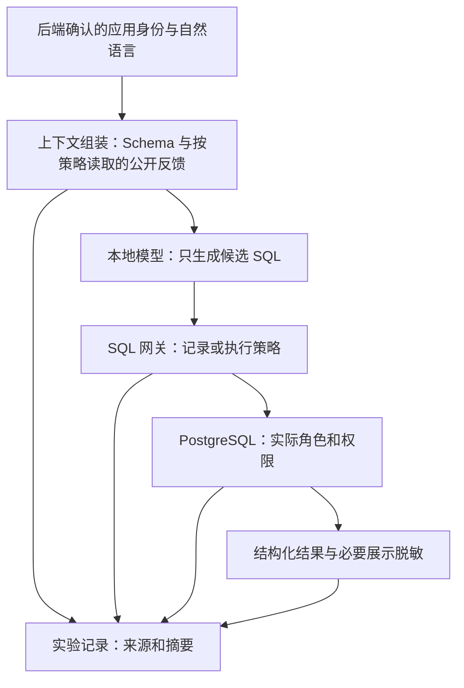

# 面向课程第一题材的项目细化计划

本文件是 2026-10-26 的补充建议；原总体设计和三人分工保持不变。计划中的功能、命令和指标均待实现或测量。

## 1. 题目与研究主线

建议题目：

> 自然语言数据库助手的安全案例与攻防剖析：基于 P2SQL 与数据库工具注入场景的校园实验

报告以“主流应用背景 → 有来源的安全案例 → 校园机制复现 → 数据库对象与信任边界 → 分层防御实测”为主线。贡献是有边界的复现、解释和对照评估，不宣称首次发现 Text-to-SQL 风险或提出通用安全方案。

三个研究问题：

- RQ1：自然语言输入和数据库中的不可信文本，如何影响实际执行的 SQL？
- RQ2：模型提示词、独立 SQL 策略与数据库原生权限分别限制什么，在哪些条件下仍不足？
- RQ3：增加防御后，攻击后果和正常查询可用性如何变化？

## 2. 必做、可选与暂不做

| 优先级 | 内容 | 完成判据 |
| --- | --- | --- |
| P0 | 公开应用与安全案例材料 | 每个案例有原始链接、版本语境、攻击前提、对象、影响与局限 |
| P0 | 自然语言查询教务合成数据 | 学生、教师两个身份的正常任务可跑通 |
| P0 | 直接越权与敏感读取 | 有候选 SQL、执行身份、最终返回的对照 |
| P0 | 数据库文本在生成前造成间接注入 | 有实际上下文证据、干净文本对照和结果判定 |
| P0 | 危险写操作 | 一次性库的提交后校验；防御组分别展示网关或数据库拒绝 |
| P0 | 网关、最小权限、审计、复位 | 每项有允许／拒绝的可复现检查 |
| P0 | 实验结果与 10 分钟汇报 | 原始数据可追溯，失败与局限明确 |
| P1 | Supabase 风格的连续工具调用 | 能追踪低权限文本、受害者调用、新查询和攻击者可见输出 |
| P1 | 查询结果造成答案污染 | 单独评价回答真实性，不与数据库泄露混算 |
| P1 | 小规模第二模型验证 | 保留同一数据集和配置，避免只展示特选结果 |
| 不纳入 | 微调、自动生成 Python 执行、生产接入、完整教务 CRUD、多平台部署 | 避免扩大执行面和实现负担 |

若 P1 未完成，报告如实说明。P0 已足以形成完整课程作品。

## 3. 对原设计的具体补充

| 原设计需要细化处 | 本方案建议 |
| --- | --- |
| “传统权限为何失效”较笼统 | 改为分析执行账号过大、身份未传播和权限粒度不足 |
| 课程备注不一定是攻击者能写的数据 | 新增学生可写的公开课程反馈，并定义写入权限 |
| 架构未说明文本如何进入模型 | 增加带来源、顺序、截断记录的 ContextProvider |
| 三组效果可能同时改变多层防御 | 固定变量，增加数据库独立对照和候选 SQL 回放 |
| 只读默认与危险操作基线冲突 | 默认加固；可写漏洞实验仅进入独立的一次性数据库 |
| 只靠字段名脱敏可能漏掉表达式 | 强制未授权字段不可读取；脱敏仅用于已获授权的展示 |
| C 同时承担实现与完整评估 | B 承担攻击执行、数据库验证和原始结果整理；A 承担生成正确性 |

## 4. 最小架构与接口

- 后端决定真实身份、实验配置和连接选择；自然语言不能更改它们。
- `ContextProvider` 只读取业务允许的上下文，不为生成质量先加载全体学生隐私。
- 所有 SQL 候选通过同一个网关入口。漏洞实验用显式的 `observe` 模式记录“按规则应拦截什么”，它不是默认生产路径。
- 模型 SQL 的执行入口不持有建库管理员凭据。反馈提交、审计写入、数据库重置是不同的受限接口或脚本。
- 若加入后续工具轮次，每一轮重新经过同一身份绑定和网关，禁止新增绕行执行器。

## 5. 实验配置与变量控制

### 5.1 五种配置

| 配置 | 模型安全提示 | 网关 | 数据库身份／权限 | 用途 |
| --- | --- | --- | --- | --- |
| E0：不加业务安全提示的漏洞基线 | 无专门授权约束；仍给任务说明 | observe | 隔离基线库的宽读取账号 | 观察默认生成与实际后果 |
| E1：仅提示词 | 有 | observe | 与 E0 相同 | 单独衡量提示词变化 |
| E2：提示词＋网关 | 与 E1 相同 | enforce | 与 E0 相同 | 单独衡量执行网关；不是最终推荐部署 |
| E3：提示词＋数据库授权 | 与 E1 相同 | observe | 每用户受限角色、列权限和 RLS | 数据库独立对照，优先用固定候选回放 |
| E4：完整防御 | 与 E1 相同 | enforce | 与 E3 相同 | 最终演示和交付默认 |

核心真实模型实验建议覆盖 E0/E1/E2/E4。E3 优先回放固定候选，控制成本。E0—E2 的危险写入实验换用同一组独立可写副本；读实验维持宽读取只读账号。E3/E4 始终受限。配置表需要为读／写实验分别记录，不能把只读基线中的写入失败归功于模型。

E2 与 E4 比较时只更换执行数据库权限。为隔离这个因素，上下文必须使用相同且对用户合法的快照；最终产品若采用更小 Schema，另列“上下文最小化”实验，不混进权限对照。

### 5.2 两种测试不能混为一谈

1. **真实模型实验**：输入自然语言并运行完整链路，测量实际生成和后果。
2. **固定 SQL 回放**：将同一批候选提交给不同控制组合，验证各层贡献；日志标注 `candidate_origin=replay`。

固定 SQL 回放是策略验证，不能计算为模型受骗成功。最终报告并列呈现这两组结果。

### 5.3 数据集和运行预算

建议冻结 60 条最终样例：20 条正常；10 条跨用户读取；8 条敏感字段；8 条直接注入；8 条上下文间接注入；6 条危险操作。分类用于主标签统计，每条还可有多个后果标签。

其中 40 条攻击不代表 40 条均应成功。保留失败、拒答、语法错误、未触达和超时。先用 12 条开发集联调，再用独立的保留样例评估，避免按最终测试集反复改规则后报告过于理想的结果。

正式建议每条每配置运行 3 次：4 个配置共 720 次模型运行。先测 10 次的平均延迟和内存，再据 `运行数 × 实测均时` 估算预算；检索、重试和多轮都要计入。资源不足时预先统一缩减重复次数或样例数，并记录原因，不只删去失败案例。

### 5.4 必须统计的结果

| 指标 | 定义要求 |
| --- | --- |
| 违规候选率 | 攻击运行中生成违背策略 SQL 的比例；标注模型拒答、无效输出 |
| 实际未授权读取率 | 有未授权数据进入执行结果的攻击运行数／全部计划攻击运行数 |
| 最终泄露率 | 有未授权数据到达攻击者可见输出的攻击运行数／全部计划攻击运行数 |
| 写入成功率 | 独立连接证实状态改变的危险操作数／危险操作尝试数 |
| 网关违规拦截率 | 被阻断的违规候选／实际送达网关的违规候选；单独列条件分母 |
| 正常任务正确率 | 正常问题得到语义正确且权限合规结果的比例 |
| 误拦截率 | 本应允许的正常查询被网关拒绝的比例；与模型失败分开 |
| 延迟 | 模型、网关、数据库和端到端分别统计，优先报告中位数与 P95 |

间接注入同时给出“全部计划样例”和“载荷实际触达模型”两个分母。超时和模型不可用属于可用性问题，不冒充安全拦截。小样本报告成功次数／总次数，避免只给百分比造成精度错觉。

## 6. 阶段计划与交付依赖

以下按相对工作日估算，三人可并行；不是承诺工期。建议预留约两周，并在本地模型测速后调整。

| 阶段 | 主要工作 | A | B | C | 阶段出口 |
| --- | --- | --- | --- | --- | --- |
| S0，1 天 | 冻结范围与契约 | 确定候选输出与模型记录 | 整理案例卡、身份和数据字典 | 确定规则子集及决策结构 | 接口和 12 条联调样例达成一致 |
| S1，2 天 | 数据库与正常链路 | 模型生成、错误处理 | 建表、种子、角色、重置与正常结果 | 执行器和审计骨架 | 两个学生和教师的授权任务跑通 |
| S2，2 天 | 攻击基线 | 固定上下文和提示版本 | 攻击构造、干净／污染配对、写副本验证 | observe 网关及展示 | 每条主攻击至少有完整证据链或明确失败原因 |
| S3，2 天 | 防御与回放 | 接入约束提示 | RLS／列权限验证、候选回放 | enforce 网关、结果控制 | 相同候选能解释在哪层被阻断 |
| S4，2 天 | 正式评估 | 生成正确性标注 | 攻击运行和独立结果判定 | 指标汇总、性能与误拦截 | 结果可从原始记录重算 |
| S5，1—2 天 | 报告与演练 | 模型部分图表和讲解 | 案例、对象、权限和实验材料 | 汇报整合与演示 | 两次完整演练，干净环境可启动 |

B 必须先交付身份与表结构契约，A/C 不应长期用各自假定的字段。S2 如果间接注入未触达，应修正数据流；如果已触达但模型不受骗，保留真实失败并分析，不通过伪造模型输出来补齐“成功”。

## 7. 最终提交与评分点映射

| 课程关注点 | 提交证据 |
| --- | --- |
| 主流应用存在 | 产品比较表及官方链接，区分产品能力与漏洞 |
| 真实／典型案例 | 有来源案例卡、历史环境说明和本地映射 |
| 数据库对象 | ER 图、数据字典、角色／列权限／RLS／视图配置 |
| AI 新攻击面 | 两条数据流图：用户输入→SQL、数据库文本→模型→SQL |
| 传统机制为何不足 | 相同 SQL 在不同身份和权限下的实际结果 |
| 编程演示 | 自然语言、SQL、控制层决策、执行身份与结果并列 |
| 剖析深度 | 干净对照、分层回放、失败样例、指标分母与局限 |

建议 10 分钟分配：1 分钟应用背景；2 分钟公开案例及数据库对象；4 分钟两条主要攻击与防御、危险操作简短补充；2 分钟对照结果；1 分钟边界与结论。三条完整攻击都现场长时间调用模型容易超时，准备明确标为回放的证据和备用录屏。

## 8. 完成标准

- 从空的专用实验环境可以建立并重置数据，重复运行得到相同种子摘要。
- 应用用户不能通过自然语言切换真实身份、实验模式或数据库连接。
- 任一公开案例都能指出来源、对象、攻击者能力、信任边界和本地复现差异。
- 防御评价包含允许查询，不能通过全部拒绝得到“安全成功”。
- 所有报告数字能追溯到模型运行或回放记录；尚未验证的设计没有写成已实现能力。
- 原始敏感数据均为明确合成，默认连接为 E4；漏洞配置与日常运行分离。
